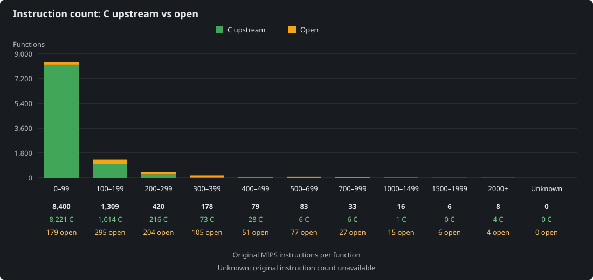

<!-- Generated by ci/update_coverage.py. Do not edit by hand. -->

# Decompilation coverage

## Functions by instruction count

US bucket totals are retained from this table; open function sizes are counted from regenerated original assembly. Counts describe functions, not executed instructions or runtime test coverage.

| Original instructions | C upstream | Open | Total | Complete |
| --- | ---: | ---: | ---: | ---: |
| 0–99 | 8,331 | 69 | 8,400 | 99.2% |
| 100–199 | 1,212 | 97 | 1,309 | 92.6% |
| 200–299 | 311 | 109 | 420 | 74.0% |
| 300–399 | 113 | 65 | 178 | 63.5% |
| 400–499 | 43 | 36 | 79 | 54.4% |
| 500–699 | 27 | 56 | 83 | 32.5% |
| 700–999 | 8 | 25 | 33 | 24.2% |
| 1000–1499 | 2 | 14 | 16 | 12.5% |
| 1500–1999 | 1 | 5 | 6 | 16.7% |
| 2000+ | 4 | 4 | 8 | 50.0% |
| Unknown | 0 | 0 | 0 | — |

<!-- AUTO_COVERAGE:START -->
- US functions with C implementations: **10,052 / 10,532 (95.4%)**
- Remaining `GLOBAL_ASM` owners: **480**
- Baseline: **10,532** US `GLOBAL_ASM` owners in the original pragma snapshot
<!-- AUTO_COVERAGE:END -->

## Remaining owners by source file

| File | Remaining | Baseline total | Percent complete |
| --- | ---: | ---: | ---: |
| `src/14640.c` | 2 | 117 | 98.3% |
| `src/1CDC0.c` | 2 | 37 | 94.6% |
| `src/23D10.c` | 4 | 20 | 80.0% |
| `src/26CC0.c` | 10 | 10 | 0.0% |
| `src/2C1B0.c` | 3 | 15 | 80.0% |
| `src/585D0.c` | 1 | 229 | 99.6% |
| `src/641E0.c` | 1 | 44 | 97.7% |
| `src/654A0.c` | 4 | 11 | 63.6% |
| `src/6670.c` | 1 | 19 | 94.7% |
| `src/6AA80.c` | 2 | 74 | 97.3% |
| `src/6E850.c` | 3 | 55 | 94.5% |
| `src/72C30.c` | 1 | 16 | 93.8% |
| `src/CE80.c` | 1 | 48 | 97.9% |
| `src/audio_cue_dispatch.c` | 1 | 1 | 0.0% |
| `src/fragments/1/fragment1_code.c` | 4 | 24 | 83.3% |
| `src/fragments/10/fragment10_D5250.c` | 3 | 27 | 88.9% |
| `src/fragments/11/fragment11_D7BC0.c` | 2 | 39 | 94.9% |
| `src/fragments/11/fragment11_D9DE0.c` | 4 | 26 | 84.6% |
| `src/fragments/11/fragment11_E1E10.c` | 1 | 30 | 96.7% |
| `src/fragments/12/fragment12_E7C00.c` | 3 | 72 | 95.8% |
| `src/fragments/13/fragment13_EEC50.c` | 1 | 79 | 98.7% |
| `src/fragments/14/fragment14_104FC0.c` | 1 | 26 | 96.2% |
| `src/fragments/14/fragment14_1077C0.c` | 1 | 28 | 96.4% |
| `src/fragments/14/fragment14_F81B0.c` | 1 | 55 | 98.2% |
| `src/fragments/14/fragment14_FA520.c` | 1 | 9 | 88.9% |
| `src/fragments/14/fragment14_FAD40.c` | 1 | 46 | 97.8% |
| `src/fragments/14/fragment14_FF070.c` | 8 | 91 | 91.2% |
| `src/fragments/16/fragment16_code.c` | 2 | 29 | 93.1% |
| `src/fragments/17/fragment17_10FFC0.c` | 3 | 56 | 94.6% |
| `src/fragments/17/fragment17_113A60.c` | 6 | 82 | 92.7% |
| `src/fragments/17/fragment17_1162A0.c` | 8 | 15 | 46.7% |
| `src/fragments/17/fragment17_11A7F0.c` | 2 | 5 | 60.0% |
| `src/fragments/17/fragment17_11B210.c` | 1 | 28 | 96.4% |
| `src/fragments/19/fragment19_121100.c` | 5 | 54 | 90.7% |
| `src/fragments/19/fragment19_124E40.c` | 3 | 22 | 86.4% |
| `src/fragments/2/fragment2_code.c` | 3 | 7 | 57.1% |
| `src/fragments/20/fragment20_128B10.c` | 3 | 35 | 91.4% |
| `src/fragments/20/fragment20_12C460.c` | 17 | 146 | 88.4% |
| `src/fragments/21/fragment21_13FFA0.c` | 9 | 56 | 83.9% |
| `src/fragments/21/fragment21_144790.c` | 2 | 46 | 95.7% |
| `src/fragments/22/fragment22_14A2E0.c` | 1 | 12 | 91.7% |
| `src/fragments/22/fragment22_14B090.c` | 1 | 40 | 97.5% |
| `src/fragments/23/fragment23_code.c` | 3 | 20 | 85.0% |
| `src/fragments/24/fragment24_14FE20.c` | 1 | 10 | 90.0% |
| `src/fragments/24/fragment24_150C10.c` | 11 | 92 | 88.0% |
| `src/fragments/25/fragment25_15A060.c` | 1 | 30 | 96.7% |
| `src/fragments/25/fragment25_15BBC0.c` | 1 | 10 | 90.0% |
| `src/fragments/29/fragment29_167940.c` | 1 | 9 | 88.9% |
| `src/fragments/29/fragment29_168330.c` | 2 | 30 | 93.3% |
| `src/fragments/29/fragment29_16B030.c` | 1 | 6 | 83.3% |
| `src/fragments/30/fragment30_16D4F0.c` | 2 | 16 | 87.5% |
| `src/fragments/31/fragment31_1768F0.c` | 2 | 10 | 80.0% |
| `src/fragments/31/fragment31_177430.c` | 3 | 8 | 62.5% |
| `src/fragments/31/fragment31_179030.c` | 1 | 15 | 93.3% |
| `src/fragments/31/fragment31_17B150.c` | 2 | 18 | 88.9% |
| `src/fragments/31/fragment31_17F280.c` | 2 | 28 | 92.9% |
| `src/fragments/31/fragment31_183700.c` | 1 | 21 | 95.2% |
| `src/fragments/31/fragment31_186690.c` | 1 | 65 | 98.5% |
| `src/fragments/31/fragment31_189760.c` | 3 | 5 | 40.0% |
| `src/fragments/31/fragment31_190BB0.c` | 1 | 32 | 96.9% |
| `src/fragments/31/fragment31_194C30.c` | 1 | 8 | 87.5% |
| `src/fragments/31/fragment31_195910.c` | 1 | 5 | 80.0% |
| `src/fragments/31/fragment31_1965A0.c` | 1 | 9 | 88.9% |
| `src/fragments/31/fragment31_197640.c` | 5 | 38 | 86.8% |
| `src/fragments/31/fragment31_19E800.c` | 1 | 13 | 92.3% |
| `src/fragments/31/fragment31_1A03C0.c` | 1 | 17 | 94.1% |
| `src/fragments/31/fragment31_1A1BD0.c` | 1 | 17 | 94.1% |
| `src/fragments/32/fragment32_1B1330.c` | 2 | 22 | 90.9% |
| `src/fragments/32/fragment32_1B6E40.c` | 1 | 12 | 91.7% |
| `src/fragments/32/fragment32_1B9390.c` | 1 | 3 | 66.7% |
| `src/fragments/32/fragment32_1B9840.c` | 1 | 2 | 50.0% |
| `src/fragments/33/fragment33_code.c` | 1 | 12 | 91.7% |
| `src/fragments/34/fragment34_1BE300.c` | 2 | 16 | 87.5% |
| `src/fragments/34/fragment34_1C1BC0.c` | 1 | 29 | 96.6% |
| `src/fragments/34/fragment34_1C3FA0.c` | 2 | 11 | 81.8% |
| `src/fragments/34/fragment34_1C5AA0.c` | 4 | 52 | 92.3% |
| `src/fragments/37/fragment37_code.c` | 3 | 16 | 81.2% |
| `src/fragments/38/fragment38_1D5610.c` | 2 | 21 | 90.5% |
| `src/fragments/39/fragment39_1DA300.c` | 1 | 3 | 66.7% |
| `src/fragments/4/fragment4_AE600.c` | 5 | 15 | 66.7% |
| `src/fragments/40/fragment40_1DC1F0.c` | 2 | 20 | 90.0% |
| `src/fragments/40/fragment40_1E0550.c` | 2 | 23 | 91.3% |
| `src/fragments/43/fragment43_1E5A10.c` | 6 | 114 | 94.7% |
| `src/fragments/43/fragment43_1EC950.c` | 3 | 5 | 40.0% |
| `src/fragments/44/fragment44_1F0680.c` | 3 | 18 | 83.3% |
| `src/fragments/44/fragment44_1F1850.c` | 4 | 47 | 91.5% |
| `src/fragments/44/fragment44_1F5F20.c` | 1 | 14 | 92.9% |
| `src/fragments/44/fragment44_1F6BF0.c` | 1 | 12 | 91.7% |
| `src/fragments/44/fragment44_1F85B0.c` | 5 | 16 | 68.8% |
| `src/fragments/44/fragment44_1F9DB0.c` | 4 | 20 | 80.0% |
| `src/fragments/44/fragment44_1FD260.c` | 3 | 38 | 92.1% |
| `src/fragments/44/fragment44_204950.c` | 1 | 14 | 92.9% |
| `src/fragments/44/fragment44_205C30.c` | 2 | 14 | 85.7% |
| `src/fragments/44/fragment44_207AF0.c` | 2 | 28 | 92.9% |
| `src/fragments/44/fragment44_20A610.c` | 1 | 13 | 92.3% |
| `src/fragments/44/fragment44_20BDB0.c` | 2 | 7 | 71.4% |
| `src/fragments/44/fragment44_20CBF0.c` | 2 | 7 | 71.4% |
| `src/fragments/44/fragment44_20D3A0.c` | 3 | 16 | 81.2% |
| `src/fragments/44/fragment44_20F140.c` | 3 | 25 | 88.0% |
| `src/fragments/44/fragment44_212740.c` | 2 | 22 | 90.9% |
| `src/fragments/45/fragment45_2251A0.c` | 4 | 79 | 94.9% |
| `src/fragments/45/fragment45_22AB80.c` | 3 | 49 | 93.9% |
| `src/fragments/45/fragment45_2324B0.c` | 1 | 24 | 95.8% |
| `src/fragments/45/fragment45_2348E0.c` | 1 | 17 | 94.1% |
| `src/fragments/46/fragment46_code.c` | 2 | 80 | 97.5% |
| `src/fragments/47/fragment47_246640.c` | 1 | 69 | 98.6% |
| `src/fragments/47/fragment47_2507E0.c` | 1 | 3 | 66.7% |
| `src/fragments/47/fragment47_251C30.c` | 2 | 3 | 33.3% |
| `src/fragments/48/fragment48_258D80.c` | 2 | 11 | 81.8% |
| `src/fragments/49/fragment49_code.c` | 6 | 116 | 94.8% |
| `src/fragments/50/fragment50_266A60.c` | 4 | 52 | 92.3% |
| `src/fragments/50/fragment50_26BF40.c` | 1 | 16 | 93.8% |
| `src/fragments/51/fragment51_27AC10.c` | 1 | 12 | 91.7% |
| `src/fragments/51/fragment51_27B9E0.c` | 1 | 17 | 94.1% |
| `src/fragments/52/fragment52_27E4E0.c` | 3 | 56 | 94.6% |
| `src/fragments/52/fragment52_2853B0.c` | 1 | 3 | 66.7% |
| `src/fragments/52/fragment52_285750.c` | 1 | 6 | 83.3% |
| `src/fragments/52/fragment52_2862C0.c` | 1 | 9 | 88.9% |
| `src/fragments/53/fragment53_code.c` | 15 | 54 | 72.2% |
| `src/fragments/54/fragment54_code.c` | 7 | 43 | 83.7% |
| `src/fragments/55/fragment55_code.c` | 10 | 53 | 81.1% |
| `src/fragments/56/fragment56_code.c` | 7 | 46 | 84.8% |
| `src/fragments/57/fragment57_code.c` | 9 | 32 | 71.9% |
| `src/fragments/58/fragment58_code.c` | 7 | 25 | 72.0% |
| `src/fragments/59/fragment59_code.c` | 8 | 44 | 81.8% |
| `src/fragments/60/fragment60_code.c` | 12 | 67 | 82.1% |
| `src/fragments/61/fragment61_code.c` | 13 | 57 | 77.2% |
| `src/fragments/63/fragment63_305090.c` | 1 | 21 | 95.2% |
| `src/fragments/63/fragment63_306150.c` | 2 | 28 | 92.9% |
| `src/fragments/63/fragment63_308D70.c` | 3 | 39 | 92.3% |
| `src/fragments/63/fragment63_30B540.c` | 2 | 51 | 96.1% |
| `src/fragments/63/fragment63_30F070.c` | 1 | 25 | 96.0% |
| `src/fragments/63/fragment63_315A90.c` | 1 | 39 | 97.4% |
| `src/fragments/63/fragment63_3166F0.c` | 1 | 1 | 0.0% |
| `src/fragments/63/fragment63_317060.c` | 1 | 74 | 98.6% |
| `src/fragments/63/fragment63_319010.c` | 2 | 8 | 75.0% |
| `src/fragments/63/fragment63_31CB20.c` | 1 | 3 | 66.7% |
| `src/fragments/64/fragment64_3235A0.c` | 1 | 11 | 90.9% |
| `src/fragments/64/fragment64_326ED0.c` | 3 | 17 | 82.4% |
| `src/fragments/64/fragment64_3290A0.c` | 1 | 13 | 92.3% |
| `src/fragments/64/fragment64_32AEF0.c` | 1 | 11 | 90.9% |
| `src/fragments/64/fragment64_32DC40.c` | 1 | 11 | 90.9% |
| `src/fragments/64/fragment64_32F5F0.c` | 1 | 8 | 87.5% |
| `src/fragments/66/fragment66_code.c` | 5 | 33 | 84.8% |
| `src/fragments/67/fragment67_33CB20.c` | 1 | 10 | 90.0% |
| `src/fragments/67/fragment67_343510.c` | 1 | 13 | 92.3% |
| `src/fragments/67/fragment67_344D70.c` | 1 | 90 | 98.9% |
| `src/fragments/67/fragment67_34B0F0.c` | 2 | 15 | 86.7% |
| `src/fragments/67/fragment67_34C8B0.c` | 1 | 16 | 93.8% |
| `src/fragments/69/fragment69_code.c` | 2 | 46 | 95.7% |
| `src/fragments/7/fragment7_BA250.c` | 5 | 100 | 95.0% |
| `src/fragments/72/fragment72_code.c` | 1 | 22 | 95.5% |
| `src/fragments/73/fragment73_code.c` | 2 | 8 | 75.0% |
| `src/fragments/74/fragment74_code.c` | 2 | 11 | 81.8% |
| `src/fragments/75/fragment75_code.c` | 3 | 16 | 81.2% |
| `src/fragments/77/fragment77_code.c` | 2 | 30 | 93.3% |
| `src/fragments/79/fragment79_36F8B0.c` | 1 | 42 | 97.6% |
| `src/fragments/79/fragment79_375530.c` | 1 | 30 | 96.7% |
| `src/fragments/79/fragment79_377570.c` | 1 | 20 | 95.0% |
| `src/fragments/79/fragment79_37A6E0.c` | 1 | 330 | 99.7% |
| `src/fragments/79/fragment79_38EFE0.c` | 2 | 109 | 98.2% |
| `src/fragments/79/fragment79_393CA0.c` | 2 | 461 | 99.6% |
| `src/fragments/79/fragment79_3A4030.c` | 1 | 15 | 93.3% |
| `src/fragments/79/fragment79_3ADCA0.c` | 4 | 166 | 97.6% |
| `src/fragments/79/fragment79_3B7EA0.c` | 2 | 49 | 95.9% |
| `src/fragments/79/fragment79_3B9B80.c` | 3 | 28 | 89.3% |
| `src/fragments/79/fragment79_3BC290.c` | 1 | 36 | 97.2% |
| `src/fragments/79/fragment79_3BF4C0.c` | 2 | 66 | 97.0% |
| `src/fragments/79/fragment79_3C40B0.c` | 1 | 23 | 95.7% |
| `src/fragments/79/fragment79_3C50B0.c` | 1 | 25 | 96.0% |
| `src/fragments/79/fragment79_3C60B0.c` | 1 | 110 | 99.1% |
| `src/fragments/8/fragment8_code.c` | 3 | 32 | 90.6% |
| `src/fragments/82/fragment82_420EA0.c` | 2 | 39 | 94.9% |
| `src/fragments/82/fragment82_4238F0.c` | 2 | 58 | 96.6% |
| `src/fragments/83/fragment83_code.c` | 3 | 64 | 95.3% |
| `src/fragments/84/fragment84_code.c` | 3 | 42 | 92.9% |
| `src/fragments/9/fragment9_code.c` | 7 | 36 | 80.6% |
