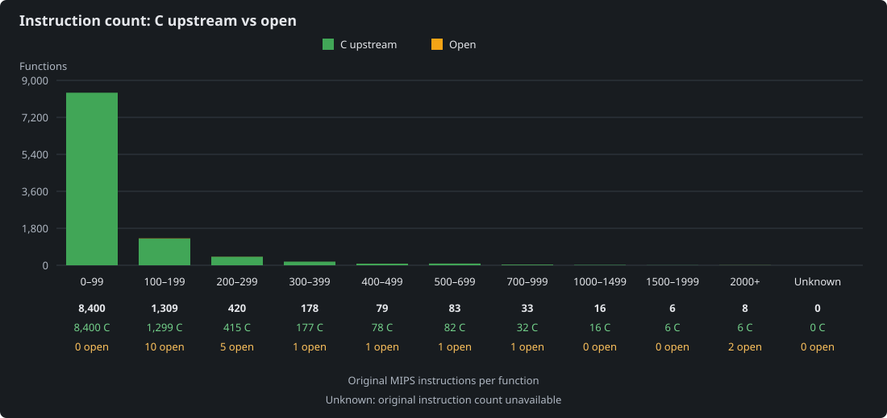

<!-- Generated by ci/update_coverage.py. Do not edit by hand. -->

# Decompilation coverage

## Functions by instruction count

US bucket totals are retained from this table; open function sizes are counted from regenerated original assembly. Counts describe functions, not executed instructions or runtime test coverage.

| Original instructions | C upstream | Open | Total | Complete |
| --- | ---: | ---: | ---: | ---: |
| 0–99 | 8,399 | 1 | 8,400 | 99.9% |
| 100–199 | 1,298 | 11 | 1,309 | 99.1% |
| 200–299 | 389 | 31 | 420 | 92.6% |
| 300–399 | 163 | 15 | 178 | 91.5% |
| 400–499 | 76 | 3 | 79 | 96.2% |
| 500–699 | 77 | 6 | 83 | 92.7% |
| 700–999 | 31 | 2 | 33 | 93.9% |
| 1000–1499 | 15 | 1 | 16 | 93.7% |
| 1500–1999 | 6 | 0 | 6 | 100.0% |
| 2000+ | 6 | 2 | 8 | 75.0% |
| Unknown | 0 | 0 | 0 | — |

<!-- AUTO_COVERAGE:START -->
- US functions with C implementations: **10,460 / 10,532 (99.3%)**
- Remaining `GLOBAL_ASM` owners: **72**
- Baseline: **10,532** US `GLOBAL_ASM` owners in the original pragma snapshot
<!-- AUTO_COVERAGE:END -->

## Remaining owners by source file

| File | Remaining | Baseline total | Percent complete |
| --- | ---: | ---: | ---: |
| `src/290C0.c` | 1 | 6 | 83.3% |
| `src/fragments/1/fragment1_code.c` | 1 | 24 | 95.8% |
| `src/fragments/11/fragment11_D9DE0.c` | 1 | 26 | 96.1% |
| `src/fragments/12/fragment12_E7C00.c` | 1 | 72 | 98.6% |
| `src/fragments/14/fragment14_FF070.c` | 1 | 91 | 98.9% |
| `src/fragments/17/fragment17_10FFC0.c` | 2 | 56 | 96.4% |
| `src/fragments/17/fragment17_113A60.c` | 1 | 82 | 98.7% |
| `src/fragments/17/fragment17_118870.c` | 1 | 7 | 85.7% |
| `src/fragments/19/fragment19_121100.c` | 2 | 54 | 96.2% |
| `src/fragments/20/fragment20_12C460.c` | 4 | 146 | 97.2% |
| `src/fragments/21/fragment21_13FFA0.c` | 3 | 56 | 94.6% |
| `src/fragments/21/fragment21_144790.c` | 2 | 46 | 95.6% |
| `src/fragments/24/fragment24_150C10.c` | 2 | 92 | 97.8% |
| `src/fragments/29/fragment29_16B030.c` | 1 | 6 | 83.3% |
| `src/fragments/31/fragment31_189760.c` | 1 | 5 | 80.0% |
| `src/fragments/31/fragment31_197640.c` | 1 | 38 | 97.3% |
| `src/fragments/32/fragment32_1B1330.c` | 1 | 22 | 95.4% |
| `src/fragments/34/fragment34_1C5AA0.c` | 1 | 52 | 98.0% |
| `src/fragments/4/fragment4_AE600.c` | 1 | 15 | 93.3% |
| `src/fragments/44/fragment44_1F1850.c` | 1 | 47 | 97.8% |
| `src/fragments/44/fragment44_1FD260.c` | 1 | 38 | 97.3% |
| `src/fragments/45/fragment45_2251A0.c` | 1 | 79 | 98.7% |
| `src/fragments/46/fragment46_code.c` | 1 | 80 | 98.7% |
| `src/fragments/47/fragment47_251C30.c` | 1 | 3 | 66.6% |
| `src/fragments/49/fragment49_code.c` | 2 | 116 | 98.2% |
| `src/fragments/50/fragment50_266A60.c` | 1 | 52 | 98.0% |
| `src/fragments/51/fragment51_27AC10.c` | 1 | 12 | 91.6% |
| `src/fragments/53/fragment53_28E360.c` | 3 | 6 | 50.0% |
| `src/fragments/53/fragment53_code.c` | 2 | 54 | 96.2% |
| `src/fragments/54/fragment54_code.c` | 6 | 43 | 86.0% |
| `src/fragments/55/fragment55_code.c` | 2 | 53 | 96.2% |
| `src/fragments/57/fragment57_code.c` | 2 | 32 | 93.7% |
| `src/fragments/58/fragment58_code.c` | 3 | 25 | 88.0% |
| `src/fragments/59/fragment59_code.c` | 3 | 44 | 93.1% |
| `src/fragments/61/fragment61_code.c` | 2 | 57 | 96.4% |
| `src/fragments/63/fragment63_31CB20.c` | 1 | 3 | 66.6% |
| `src/fragments/64/fragment64_32AEF0.c` | 1 | 11 | 90.9% |
| `src/fragments/69/fragment69_code.c` | 2 | 46 | 95.6% |
| `src/fragments/7/fragment7_BA250.c` | 1 | 100 | 99.0% |
| `src/fragments/75/fragment75_code.c` | 1 | 16 | 93.7% |
| `src/fragments/77/fragment77_code.c` | 1 | 30 | 96.6% |
| `src/fragments/79/fragment79_377570.c` | 1 | 20 | 95.0% |
| `src/fragments/79/fragment79_3B7EA0.c` | 1 | 49 | 97.9% |
| `src/fragments/79/fragment79_3B9B80.c` | 1 | 28 | 96.4% |
| `src/fragments/82/fragment82_4238F0.c` | 1 | 58 | 98.2% |
| `src/fragments/83/fragment83_code.c` | 1 | 64 | 98.4% |
